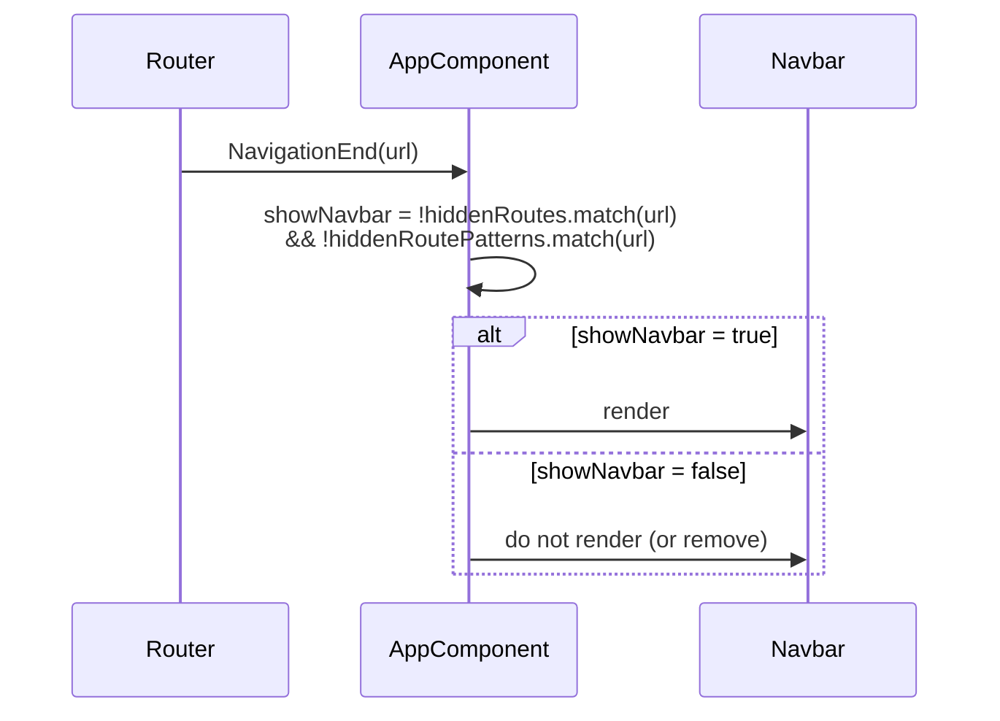

# Navbar — Tech Design (5 min)

> The persistent top bar on every authenticated screen. Component lives at `src/app/components/layout/navbar/navbar.component.ts` (standalone, signals-based). Visibility is owned by `AppComponent`.

## What we're building

One standalone component with three visible slots (brand, notifications, avatar) and one floating slot (avatar dropdown menu: name, Profile, Log out). Mounted by `AppComponent` only when the current URL is not on the deny-list.

## System context

```
            +-------------------+   showNavbar()
 Router --> | AppComponent      |---+---------------+
 events     |                   |   |               |
            |  hiddenRoutes[]   |   v               v
            |  hiddenRoute      |  <app-navbar />   <router-outlet />
            |  Patterns[]       |
            +---------+---------+
                      |
                      |  signals + ngOnInit
                      v
                AuthService.userName() / userInitial()   (computed from currentUser)
                AuthService.isAuthenticated() → MeService.getMe() → AuthService.setCurrentUser()
                AuthService.logout() → Router.navigate(['/login'])
                routerLink /profile
```

Sibling integration points:

- `AppComponent` (`src/app/app.component.ts`) — owns `showNavbar` and the deny-list.
- `AuthService` (`src/app/services/auth.service.ts`) — source of name/initial signals and logout.
- `MeService` (`src/app/services/me.service.ts`) — one `GET /v1/users/me` on mount when authenticated.
- `/profile` — Profile screen writes the same `currentUser` signal.

## Data flow

| Signal / source | Origin | Drives |
|---|---|---|
| `showNavbar` (in `AppComponent`) | `Router.events` filtered to `NavigationEnd` → `urlAfterRedirects` | Whether `<app-navbar>` is rendered |
| `userInitial` | `AuthService.userInitial` (computed) | Avatar text |
| `userName` | `AuthService.userName` (computed: name \|\| username) | Name row inside avatar menu |
| `avatarMenuOpen` | `signal<boolean>(false)` | Conditionally renders the dropdown menu; `aria-expanded` on the avatar button |

Name and initial are the service's computed signals, so any `setCurrentUser` call (login, Profile save, the on-mount refresh) updates the navbar without a remount. `ngOnInit` calls `MeService.getMe()` when authenticated and pushes the result into `setCurrentUser`; errors are swallowed.

### Visibility-decision sequence



### Avatar menu close behaviour

- **Click on avatar** → handler stops propagation; `avatarMenuOpen.update(o => !o)`.
- **Click anywhere else** → `document:click` host listener on the navbar fires; if `avatarMenuOpen()`, set it to `false`.
- **Click inside the menu container** → menu's own `(click)` handler calls `event.stopPropagation()`, so the host listener never fires.
- **Click Profile** → `closeMenu()` sets `avatarMenuOpen` to `false`; `routerLink` navigates to `/profile` (navbar stays mounted).
- **Click Log out** → navigates away; navbar unmounts.

## Tradeoffs

| Choice | Gives us | Costs |
|---|---|---|
| Centralized `showNavbar` in `AppComponent` | One place to add new full-screen routes | Per-route opt-out lives outside the route definition itself |
| `document:click` listener for click-outside | Zero infrastructure, no CDK overlay | A subscribed handler runs for every click on every authenticated screen |
| Bind to `AuthService` computed signals | Profile edits show at once; no subscription code | Navbar depends on `currentUser` being kept current by every writer |
| `getMe` on mount | Picks up role grants and fills old sessions | One extra request per mount; duplicates Profile's own `getMe` on `/profile` |
| Plain CSS dropdown (`@if`) instead of CDK Menu / mat-menu | No dependency on Angular Material; styles match the design system directly | We hand-roll keyboard navigation if/when we need arrow-key cycling between menu items |
| No backend call for notifications | Keeps the navbar dependency-free for now | The bell icon is currently inert and may confuse users |

## Scope (mirrors PRD)

**In:** brand link, notifications icon (visual only), user avatar with dropdown, name label, **Profile** link, **Log out** action, on-mount user refresh, click-outside close, primary-reverse theme styling, mobile padding shrink, `aria-*` wiring.

**Out:** notifications panel, unread badge, settings entries beyond Profile, in-navbar search, language switcher, tenant switcher, keyboard shortcut to focus navbar.

## Failure modes

- **No stored user yet.** Avatar falls back to literal `U` until `getMe` resolves.
- **`getMe` fails.** Silently ignored; stored user keeps rendering. 401 is handled by `errorInterceptor`.
- **`document:click` fires before `(click)` on the avatar.** Order is: avatar click handler runs, calls `stopPropagation()`, host listener does not see the event — verified via the `event.stopPropagation()` call in `toggleAvatarMenu`.
- **`Router.navigate(['/login'])` rejects after `AuthService.logout()`.** Tokens are already cleared; the next protected route will redirect to `/login` via `authGuard`. No UI feedback in the navbar itself.
- **New full-screen route added without updating `hiddenRoutePatterns`.** Navbar appears where it should not. Mitigation is convention, not code — flagged in `prd-full.md` Risks.
