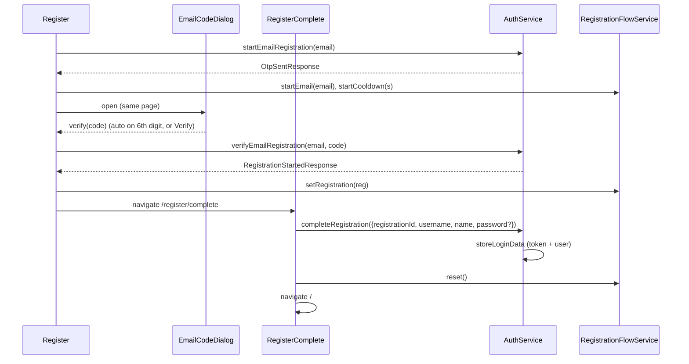

# Auth (Sign in + Sign up) — 5-min Design

> Engineering view of the public auth screens. PRD: [`prd-5min.md`](./prd-5min.md). Code: `src/app/components/auth/`.

## 1. What we're building

| Route | Component | Guard |
|---|---|---|
| `/login` | `LoginComponent` (`app-login`) | — |
| `/register` | `RegisterComponent` (`app-register`) — hosts `app-email-code-dialog` | — |
| `/register/complete` | `RegisterCompleteComponent` (`app-register-complete`) | `registrationIdGuard` |

Supporting: `AuthBrandComponent` (`app-auth-brand`, decorative panel on all three), `GoogleSignInComponent` (`app-google-sign-in`, on login and register), `EmailCodeDialogComponent` (`app-email-code-dialog`, `auth/email-code-dialog/`; wraps shared `lib-dialog` + `lib-otp-input`, also used by Profile). The two sign-up screens share `register/register.component.scss`.

## 2. System context

```
                      Router (app.routes.ts)
   /login   /register                     /register/complete ◀─guard─┐
      │         │                                  │                 │
      ▼         ▼                                  ▼                 │
   Login    Register ── app-email-code-dialog   RegisterComplete     │
      │  ╲     │  ╲       (lib-dialog +            │                 │
      │ app-google-sign-in  lib-otp-input)         │                 │
      │   (GIS script)         │                   │                 │
      ▼         ▼              ▼                   ▼                 │
   ┌──────────────────────────────────────────┐      ┌──────────────────────────┐
   │ AuthService                               │      │ RegistrationFlowService  │
   │  login / googleSignIn                     │      │  email, registration,    │
   │  startEmailRegistration                   │      │  cooldownUntil           │
   │  verifyEmailRegistration                  │      │  ↕ sessionStorage        │
   │  completeRegistration                     │      └──────────────────────────┘
   │  storeLoginData → setCurrentUser          │
   └──────────────────┬───────────────────────┘
                      ▼
   POST /v1/auth/login | /google:sign-in | /register/email | /register/email/verify | /register/complete
```

## 3. Data flow

### Email sign-up



Dialog contract (`app-email-code-dialog`): inputs `open`, `email`, `title`, `loading`, `resending`, `error`, `cooldownUntil` (epoch ms); outputs `verify(code)`, `resend`, `cancel`. The dialog never calls the server. On `/register`, `resend` re-calls `startEmailRegistration`; Continue with the same email during the cooldown reopens the dialog with no request.

### Google (login or register screen)

```
GIS button → credential(idToken) → AuthService.googleSignIn(idToken)
  ├─ login        → storeLoginData (inside service) → flow.reset() → navigate('/')
  ├─ registration → flow.setRegistration(reg) → navigate('/register/complete')  (requiresPassword = false)
  └─ error        → errorMessage.set(apiErrorMessage(err, 'Google sign-in failed. Please try again.'))
```

### Password login

`AuthService.login({ username: emailOrUsername, password })` → `storeLoginData` → `navigate('/')`; error → `apiErrorMessage`.

## 4. Key decisions & tradeoffs

| # | Decision | Why | Rejected |
|---|---|---|---|
| D-1 | Reactive Forms + local signals per screen | Validators, cross-field password match, `.invalid` drives submit | Template-driven; store |
| D-2 | Own route for the final step, code in a dialog | `/register/complete` is deep-linkable behind a guard; the code stays next to the email it went to; one dialog serves sign-up and Profile | One stepper component; a separate `/register/verify` page (shipped first, removed 2026-09) |
| D-3 | `RegistrationFlowService` + sessionStorage | Survives reload in the tab, dies with the tab, id never in URL | Router state, query params, localStorage |
| D-4 | GIS rendered button + ID token POST | No redirect URIs, no secret, one endpoint | Redirect OAuth flow; custom-styled button |
| D-5 | Shared `app-auth-brand` | One copy of the panel for three screens | Duplicate markup (previous state) |
| D-6 | `apiErrorMessage` helper | Backend envelope has `errors[0].reason`, no `message` | Reading `err.error.message` (always undefined) |
| D-7 | `setCurrentUser` stores full `user` JSON + signal | Navbar/Profile react to changes; real role stored | Only `user_name`/`user_role` strings |

## 5. Scope (mirror of PRD)

**In.** Three routes; email-or-username login; email + code sign-up (code dialog); Google sign-in/up; guard; sessionStorage flow; auto sign-in on completion; brand panel; mobile collapse at 768px.

**Out.** Password reset; refresh token; redirect-if-authenticated; other providers; MFA; captcha.

## 6. Failure modes (summary)

| Mode | UI |
|---|---|
| 401 on login | Inline reason; no refresh attempt (interceptor skips `/v1/auth/`) |
| 409 on register step 1 | "This email already has an account. Sign in instead." |
| 400 on code (invalid / expired / too many / cooldown) | Reason under the code boxes; dialog stays open |
| 409 username on complete | Under Username field |
| 404, or 409 not about username, on complete | Toast, reset, `/register` |
| 503 mail send failed | Inline reason |
| GIS script missing | No Google button; email/password still work |
| Direct URL to `/register/complete` without state | Guard → `/register` |

Full list in [`design-full.md`](./design-full.md) §7.
