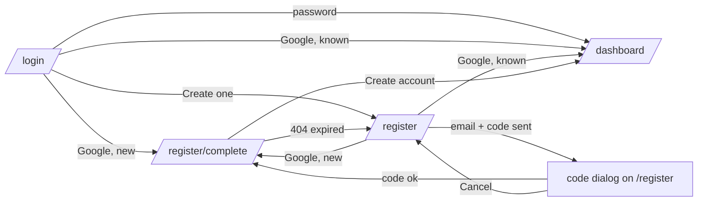

# Auth (Sign in + Sign up) — Full PRD

> Authoritative product spec for the public auth screens. Pairs with [`design-full.md`](./design-full.md) and [`contract.yaml`](./contract.yaml). Code: `src/app/components/auth/`.

## 1. Problem & users

See [`prd-1min.md`](./prd-1min.md). All screens serve signed-out users. Navbar and footer are hidden on `/login`, `/register`, `/register/complete` so each reads as a standalone page.

## 2. User journeys

- Direct visits to `/register/complete` without a registration redirect to `/register`.

## 3. Acceptance criteria

### 3.1 Sign in (`/login`)

- [ ] Heading "Welcome back", caption "Sign in to continue learning on Lib4GZ".
- [ ] Fields **Email or username** and **Password**, both required ("Email or username is required" / "Password is required" after touch).
- [ ] **Login** button disabled while invalid; loading state while submitting.
- [ ] Input with `@` signs in by email, otherwise by username (server rule).
- [ ] Success → session stored (token, expiry, `user`, `user_name`, `user_role`, `user_id`) → `/`.
- [ ] Failure → server reason (e.g. "Invalid username or password") or "Invalid credentials. Please try again.", `role="alert"`, form kept.
- [ ] "or" divider, then Google's **Sign in with Google** button.
- [ ] Google known account → any leftover sign-up state cleared → `/`. New account → `/register/complete`. Error → server reason or "Google sign-in failed. Please try again."
- [ ] "Don't have an account? **Create one**" → `/register`.

### 3.2 Sign up step 1 (`/register`)

- [ ] Heading "Create your account", caption "We'll send a 6-digit code to confirm your email".
- [ ] **Email** required + valid ("Email is required" / "Please enter a valid email").
- [ ] **Continue with email** → code sent → cooldown starts → the code dialog opens on this page (3.3).
- [ ] 409 → "This email already has an account. **Sign in** instead." with a link to `/login`.
- [ ] Other errors → server reason or "Could not send the code. Please try again."
- [ ] "or" divider + **Sign up with Google** (same outcomes as 3.1).
- [ ] "Already have an account? **Sign in**" → `/login`.
- [ ] Email field is prefilled when returning to this screen in the same tab with an email still stored. The dialog does not reopen on its own after a reload.
- [ ] **Continue with email** with the same address while the cooldown runs reopens the dialog without sending a new code.

### 3.3 Code dialog (`app-email-code-dialog` on `/register`)

- [ ] Title "Check your email", text "Enter the 6-digit code we sent to **{email}**. You can paste it."
- [ ] Six single-digit boxes (`lib-otp-input`): typing advances, Backspace goes back, arrow keys move, paste or browser autofill fills all six.
- [ ] The sixth digit submits automatically; **Verify** submits too. Fewer than 6 digits → "Enter all 6 digits" under the boxes.
- [ ] Success → registration stored → `/register/complete`. Error → server reason ("Invalid code", "Code expired or not found. Request a new one", "Too many attempts. Request a new code") or "Could not verify the code. Please try again." under the boxes; dialog stays open.
- [ ] **Resend code** disabled while the countdown runs ("Resend code in {n}s"); success → new countdown + toast "A new code is on its way"; error → reason under the boxes.
- [ ] Countdown survives a reload in the same tab.
- [ ] **Cancel** or Escape closes the dialog; the email stays in the form for editing.

### 3.4 Sign up step 2 (`/register/complete`)

- [ ] Guarded: no stored registration → `/register`.
- [ ] Heading "Set up your account", caption "Your username can't be changed later".
- [ ] **Email** read-only (from the registration).
- [ ] **Username** required, min 3, letters and digits only; **not prefilled**. Errors: "Username is required" / "Minimum 3 characters required" / "Only letters and digits allowed".
- [ ] **Display name** optional, max 255; prefilled from Google, blank on the email path. Blank → server uses the username.
- [ ] **Password** (min 8) + **Confirm password** (must match: "Passwords do not match") shown and required **only** on the email path.
- [ ] **Create account** → signed in → sign-up state cleared → `/`.
- [ ] 409 mentioning username → message under the Username field; clears when the username is edited.
- [ ] 404 → toast "This sign-up expired. Please start again." → state cleared → `/register`.
- [ ] Any other 409 (email got an account meanwhile) → toast with the server reason → state cleared → `/register`. This sign-up can never finish.
- [ ] Other errors → reason under the form.

### 3.5 Layout (all three)

- [ ] Desktop > 768px: two equal columns, brand panel (`app-auth-brand`) left, form right, full viewport height.
- [ ] ≤ 768px: brand panel hidden; form fills width with smaller padding.
- [ ] Form column max-width 400px, vertically centered; buttons full width.
- [ ] No navbar, no footer.

## 4. Edge cases

1. **Signed-in user opens `/login` or `/register`.** Form renders; signing in replaces the session. Redirect-if-authenticated is future polish.
2. **Reload while the code dialog is open, or on `/register/complete`.** Email, cooldown, and registration come back from sessionStorage; the dialog stays closed until Continue is pressed again. A new tab starts over.
3. **Google new account, then user closes tab.** Pending sign-up expires server-side after 15 minutes; nothing to clean up client-side.
4. **Google on an existing account with an unconfirmed email.** Server 400; message tells the user to sign in with password and verify in Profile.
5. **Google script never loads.** After ~5 s of polling the button area stays empty; console warning only.
6. **Email becomes taken between the code and account setup.** 409 → toast with the reason, state cleared, back to `/register`.
7. **Password manager autofill.** Submit marks all fields touched so errors surface.
8. **Wrong password.** 401 is returned to the screen; the interceptor does not attempt a token refresh for `/v1/auth/` calls.

## 5. Accessibility

- Inputs labelled through `lib-input`; field errors via its `[error]` input.
- Code boxes are a `role="group"` "One-time code", each box "Digit n of 6", `inputmode="numeric"`, `autocomplete="one-time-code"`; the error under them is `role="alert"`.
- Server error blocks use `role="alert"`.
- Enter submits each form.
- Brand panel is `aria-hidden`.
- Google's rendered button provides its own accessible name.

## 6. Open questions

- Redirect already-signed-in users away from these routes?
- Forgot password by code (planned follow-up).
- Show a visible hint when the Google button fails to load?

## 7. Decision log

| ID | Date | Decision | Rationale |
|---|---|---|---|
| P-1 | shipped | One doc set covers all auth screens | Shared layout, brand panel, services, Google button. |
| P-2 | 2026-09 | Username/password registration removed; email + code or Google only | Every account has a confirmed email. |
| P-3 | 2026-09 | Both sign-up paths end on one "Set up your account" screen | One place to choose username/name; auto sign-in on submit. |
| P-4 | 2026-09 | Username not prefilled; display name prefilled from Google | Username is permanent, so it must be a deliberate choice. |
| P-5 | 2026-09 | Password only on the email path | Google accounts sign in through Google. |
| P-6 | 2026-09 | Taken username shown inline, no auto-suffix | User stays in control of a permanent handle. |
| P-7 | shipped | No "remember me" checkbox | Token always persists in localStorage. |
| P-8 | 2026-09 | Code typed in a dialog on `/register`, not on a separate page | Email stays visible; one fewer hop; same dialog confirms emails in Profile. |
