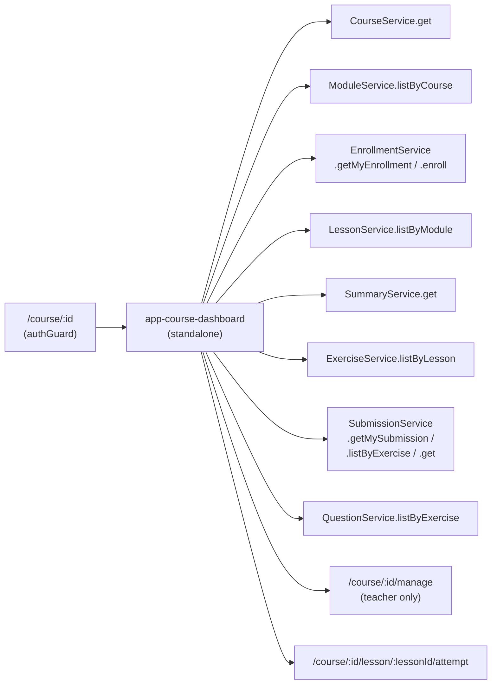
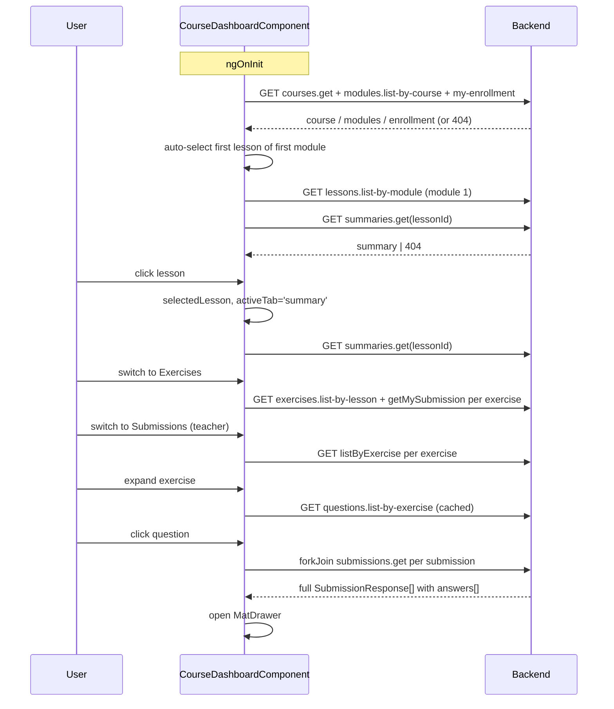

# Course Dashboard — Tech Design (5 min)

> Standalone. Expands [design-1min.md](./design-1min.md). Implementation map and decision log live in [design-full.md](./design-full.md).

## 1. What we're building

A single standalone Angular 19 component (`app-course-dashboard`) that owns the entire `/course/:id` surface for both LEARNER and TEACHER roles. It uses signals for all state, lazy-fetches per-tab and per-module data, and uses Angular Material `MatDrawer` (mode="side") for the teacher's per-question answers panel.

## 2. System context

- **Parent route guard.** `authGuard` is on `course/:id`, not on this child path.
- **Teacher gating.** Conditional in the template (`isTeacher()` from `myEnrollment().role`), not via `roleGuard`.
- **Sibling screens.** `/manage` (course management) and `/lesson/:lessonId/attempt` (exercise attempt) — both reached by navigation from this component.

## 3. Data flow

### Signal map (selected)

| Signal | Type | Purpose |
|---|---|---|
| `course` | `CourseResponse \| null` | Course header data. |
| `modules` | `ModuleResponse[]` | Sorted by `orderIndex`. |
| `lessonsByModule` | `Map<string, LessonResponse[]>` | Lazy per module. |
| `myEnrollment` | `EnrollmentResponse \| null` | Drives Manage button + content lock. |
| `selectedLesson` | `LessonResponse \| null` | Currently viewed lesson. |
| `selectedLessonPrefix` | `string` | e.g. `"1.1"` for the title. |
| `activeTab` | `'summary' \| 'exercises' \| 'submissions'` | Current tab. |
| `summary` | `SummaryResponse \| null` | Lesson summary. |
| `exercises` | `ExerciseResponse[]` | Sorted by `orderIndex`. |
| `perExerciseSubmission` | `Map<string, SubmissionResponse \| 'none'>` | Student status per exercise. |
| `exerciseSubmissions` | `Map<string, SubmissionResponse[]>` | Teacher list per exercise. |
| `expandedExerciseId` | `string \| null` | Submissions-tab card expansion. |
| `exerciseQuestions` | `Map<string, QuestionResponse[]>` | Cached on first expand. |
| `drawerQuestionId / Content / ExerciseId` | mixed | Selected question inside drawer. |
| `drawerSubmissions` | `SubmissionResponse[]` | `forkJoin` result, with answers. |
| `drawerLoading` | `boolean` | Drawer fetch state. |

`isTeacher` is a `computed` over `myEnrollment().role === EnrollmentRole.TEACHER`.

## 4. Tradeoffs

| Choice | We get | We give up |
|---|---|---|
| Single component, signals, no NgRx | Less wiring; matches project convention; easy to read in one file. | A single file that's already long; refactor to a feature module if it crosses ~600 lines. |
| Lesson navigation in-state, not in URL | No router churn; no flash of empty state; back button stays at the course root. | Deep-linking to a specific lesson requires a follow-up (out of scope this iteration). |
| `MatDrawer` mode="side" | Drawer doesn't cover context; reads as a desktop pattern. | One Angular Material dependency in an otherwise mostly-custom UI; need `::ng-deep` overrides. |
| Per-question fetch via `forkJoin(get(submissionId))` | Guaranteed full `answers[]` even if list endpoint omits them. | N parallel calls per drawer open; perf cliff at large class sizes — see open question in design-full. |
| Positional numbering (no DB column) | Free; never desyncs with edits. | Numbers shift across edits — acceptable, this is presentation. |
| Two-column shared white background (Unified Surface) | Calmer visual hierarchy; fewer visual "panels". | Easy to break — sidebar code reviewers must reject any `background:` or side `border` additions. |

## 5. Scope

**In scope.** Layout, all three tabs, accordion, mobile drawer, enrollment gating, teacher per-question drawer, linkified summaries.

**Out of scope (this iteration).**
- Deep-linking to a lesson via the URL.
- Lesson completion / progress percentages.
- Inline grading / messaging in the drawer.
- Search inside a course.
- Persisting expanded module state across reloads.

## 6. Failure modes (high-level)

- **Network down on init.** Page-level error + Retry. No partial sidebar.
- **Per-tab fetch failure.** Inline placeholder per tab; do not propagate to the whole page.
- **`forkJoin` partial failure in drawer.** Show partial results; banner for the failed ones.
- **Enrollment 404.** Treated as `null` (not-enrolled state), not as an error.
- **Empty data at any level.** Empty-state placeholder, not an error.

Detailed failure-mode table is in [design-full.md](./design-full.md).
