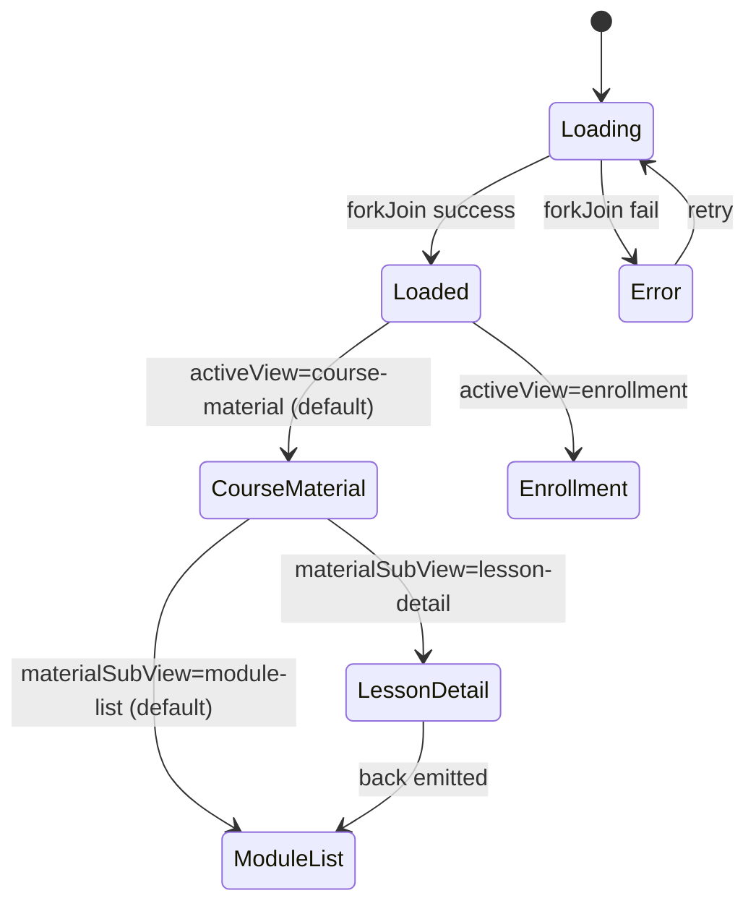

# Course Management — Tech Design (Full)

> Inherits the elevator pitch and key decisions from [design-1min.md](./design-1min.md) and the system-context diagram from [design-5min.md](./design-5min.md). This doc owns the component map, full failure-mode table, decision log with dates, and open questions.

## Component map

```
app-course-management              (this screen)
├── sidebar (inline section)
│   ├── course identity (title, description, Edit, Go to Course)
│   └── nav items
│       ├── Course Material         → activeView = 'course-material'
│       └── Enrollment [badge]      → activeView = 'enrollment'
└── content slot (centered, max-width 960px)
    ├── when activeView = 'course-material'
    │   ├── when materialSubView = 'module-list'
    │   │   └── module accordion + inline forms + delete dialog
    │   └── when materialSubView = 'lesson-detail'
    │       └── app-lesson-detail-management   (./lesson-detail-management/)
    └── when activeView = 'enrollment'
        └── app-enrollment-management          (./enrollment-management/)
```

Source files:

- `src/app/components/course-teacher/course-management/course-management.component.{ts,html,scss}`
- `src/app/components/course-teacher/course-management/lesson-detail-management/lesson-detail-management.component.{ts,html,scss}`
- `src/app/components/course-teacher/course-management/enrollment-management/enrollment-management.component.{ts,html,scss}`

Routing entry in `src/app/app.routes.ts` adds the `manage` child path under `course/:id` with `roleGuard` + `data: { roles: ['teacher'] }`.

## State machine (parent)



## Data contract

### Inputs/outputs to children

| Child | Inputs | Outputs |
|---|---|---|
| `app-lesson-detail-management` | `courseId: string`, `lesson: LessonResponse`, `moduleTitle: string` | `back`, `lessonUpdated: LessonResponse`, `exerciseDeleted: string` |
| `app-enrollment-management` | `enrollments: EnrollmentResponse[]` | `enrollmentUpdated: EnrollmentResponse`, `enrollmentRemoved: string` |

### Service surface

| Service | Method | Purpose | Owner |
|---|---|---|---|
| CourseService | `get(id)` | Initial load | parent |
| CourseService | `update(id, req)` | Edit course | parent |
| ModuleService | `listByCourse(courseId)` | Initial load | parent |
| ModuleService | `create / update / delete` | Module CRUD | parent |
| LessonService | `listByModule(moduleId)` | Lazy lesson load on expand | parent |
| LessonService | `create / delete` | Lesson CRUD | parent |
| LessonService | `update` | Title rename | parent + child (lesson detail) |
| EnrollmentService | `listByCourse(courseId)` | Initial load | parent |
| EnrollmentService | `approve / reject / update / delete` | Enrollment ops | child (enrollment management) |
| ExerciseService | `listByLesson / delete` | Lesson detail | child (lesson detail) |
| SummaryService | `get / createOrUpdate` | Lesson detail | child (lesson detail) |

API path mapping is the single-version source of truth in `documents/network/api-endpoints.yaml`. The `contract.yaml` at this folder root references endpoint ids; do not duplicate paths into the design.

## Failure modes

| # | Trigger | UI behavior | Recovery |
|---|---|---|---|
| F1 | Initial `forkJoin` fails (any of course/modules/enrollments) | Full-screen error block with message + Retry button | User clicks Retry → re-runs `forkJoin` |
| F2 | `LessonService.listByModule` fails on expand | Inline error in module body | Retry icon next to error |
| F3 | Module/lesson CRUD fails | Optimistic state rolled back; error toast | User retries action |
| F4 | Enrollment approve/reject/role/delete fails | Error toast (child handles) | User retries action |
| F5 | 401 mid-session | `errorInterceptor` redirects to `/login` | Auth flow re-acquires token |
| F6 | 403 (teacher role removed mid-session) | `errorInterceptor` redirects; on next entry, `roleGuard` blocks | User redirected to `/course/:id` |
| F7 | Lesson detail summary fetch 404 | `summary = null`, "No summary yet." placeholder shown | Not an error — expected |
| F8 | Lesson detail exercises fetch fails | Empty exercises with retry inline | Click retry |
| F9 | Network offline | Service errors propagate as toasts | When online, user retries |
| F10 | Pending badge stale (no live updates) | Badge updates on screen entry only | Document as known limitation |

## Decision log

| Date | Decision | Alternatives considered | Why |
|---|---|---|---|
| 2026-01 | Sidebar nav layout, replacing tabs | Top tabs; stacked accordion-only | Persistent course identity, room for badges, parity with student `course-dashboard`. |
| 2026-01 | Fold `enrollments` + `requests` routes into one inline view | Keep separate routes; pop-over for requests | Single context for teacher; pending count surfaces naturally as a sidebar badge. Deprecated specs archived under `documents/_archive/enrollment-management/` and `documents/_archive/enrollment-requests/`. |
| 2026-01 | Optimistic updates for module/lesson CRUD | Pessimistic with spinners | Snappier UX for the most-frequent flows; rollback complexity is acceptable. |
| 2026-01 | Lazy lesson loading per module on expand | Eager-load all lessons in `forkJoin` | Initial paint stays fast for courses with many modules. |
| 2026-02 | Lesson detail extracted into `app-lesson-detail-management` | Inline in parent | Encapsulates summary + exercises + their dialogs; simplifies parent state. |
| 2026-02 | Inline summary editing via textarea in lesson detail | Separate summary editor screen | Removes screen hop; sufficient for v1 (no rich text). |
| 2026-03 | Numbered lesson prefixes (`1.1`, `1.2`) instead of tree icons | Tree icon glyph per lesson | Order is semantic; numbered prefix matches the rest of the LMS. |
| 2026-03 | Enrollment view extracted into `app-enrollment-management` with chip filter | Select dropdown | Pending count badge attaches naturally to the chip; chips reduce click cost. |
| 2026-04 | Unified Surface (no sidebar bg/border) | Sidebar-tinted background | Calmer visual language; matches design-system principle. Hard CSS rule documented in `lib4gz-fe/CLAUDE.md`. |

## Open questions

- **Q1 — User problem framing.** The original `spec.yaml` heavily described layout/components but never named the user problem in plain terms. The PRDs here infer that the problem was *fragmented teacher workflow across three pages plus invisible pending requests*. Confirm with PM that this is accurate.
- **Q2 — Deep linking to lesson detail.** Should `/course/:id/manage/lesson/:lessonId` be supported in v2? It would simplify sharing and notifications. Out of scope for this iteration.
- **Q3 — Drag-drop reordering.** API supports `orderIndex` mutation; UI is not in v1. Decide cadence for v2.
- **Q4 — Pending badge live updates.** Polling vs event push (web push / SSE) vs entry-time only. v1 ships entry-time only.
- **Q5 — Course deletion surface.** Backend supports `CourseService.delete`; nowhere in this hub triggers it. Decide whether to add a destructive action in the sidebar Edit form, or relegate to a separate settings screen.
- **Q6 — Concurrent edit conflicts.** Last-write-wins is the v1 stance. If teachers begin to collaborate on the same course, we'll need backend versioning + optimistic concurrency.

[1-min](./design-1min.md) · [5-min](./design-5min.md) · [Contract](./contract.yaml) · [PRD](./prd-full.md)
