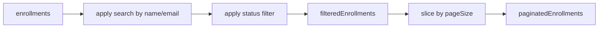

# Enrollment Management — Tech Design (5-min)

> Inline view of [Course Management](../design-5min.md). **No route.** Rendered inside the parent's content slot when `activeView === 'enrollment'`.

## What we're building

`app-enrollment-management`, a standalone child component that receives the full `enrollments[]` from the parent, applies search/chip-filter/pagination internally, and exposes per-row actions (approve, reject, toggle role with confirmation, remove with confirmation). Emits `enrollmentUpdated` / `enrollmentRemoved` so the parent reconciles its master list and refreshes the sidebar pending badge.

## System context

```mermaid
flowchart LR
  Parent[app-course-management] -->|enrollments[]| Self[app-enrollment-management]
  Self -->|enrollmentUpdated| Parent
  Self -->|enrollmentRemoved| Parent
  Self --> ESvc(EnrollmentService)
  Self --> Toast(ToastService)
  Parent -.computed pendingEnrollmentCount.-> Sidebar[(Sidebar badge)]
```

## Inputs / outputs

| Direction | Name | Type | Notes |
|---|---|---|---|
| Input | `enrollments` | `EnrollmentResponse[]` (required) | Full list. Child computes filtered + paginated views. |
| Output | `enrollmentUpdated` | `EnrollmentResponse` | Emitted after approve, reject, role-change success. |
| Output | `enrollmentRemoved` | `string` (id) | Emitted after delete success. |

## Internal state

- Filter / pagination signals: `search`, `statusFilter` (`'All' | EnrollmentStatus`), `page` (1-based). `pageSize = 20` constant.
- Computed: `pendingRequestCount`, `filteredEnrollments`, `paginatedEnrollments`, `totalPages`.
- Role-change dialog signals: `roleDialogOpen`, `roleChangeEnrollment`, `roleChangeTarget`, `changingRole`.
- Delete dialog signals: `deleteDialogOpen`, `deleteEnrollmentId`, `deleteEnrollmentName`, `deleting`.

## Filter pipeline



Search and chip changes both reset `page` to 1.

## Tradeoffs

| Decision | Got | Gave up |
|---|---|---|
| Parent owns master list, child owns view state | Single source of truth, simple sidebar reconciliation | Child can't react to external mutations without input churn |
| Client-side filter/pagination | Zero latency on filter/page change | Won't scale past a few hundred enrollments |
| Chip filter with pending count badge | Pending count always visible | Slightly more horizontal real estate than a select |
| Approve/reject without dialog | Faster triage | Misclicks are recoverable but possible |
| Hard delete (no undo) | Simple backend | No restore path |

## Scope

**In:** search, chip filter, pagination, role/status badges, approve, reject, role toggle (with confirm), remove (with confirm), parent-event reconciliation, mobile email column hide.

**Out:** bulk actions, server-side filter/pagination, invite-by-email, CSV export, soft-delete/undo, standalone route.

## Failure modes

| Mode | UI |
|---|---|
| Approve fails | Error toast; row stays PENDING |
| Reject fails | Error toast; row stays PENDING |
| Role change fails | Error toast; dialog closes; row stays |
| Remove fails | Error toast; dialog closes; row stays |
| Network offline | All mutations toast errors; user retries |
| Stale parent list | Out of scope here; parent must reconcile on emitted events |

[1-min](./design-1min.md) · [Full](./design-full.md) · [Contract](./contract.yaml) · [PRD](./prd-5min.md) · [Parent](../design-5min.md)
