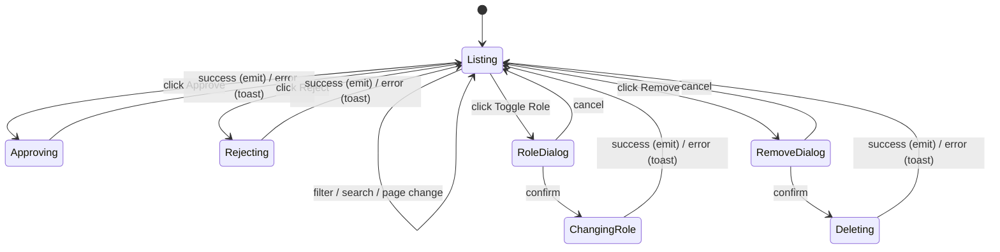

# Enrollment Management — Tech Design (Full)

> Inherits the elevator pitch and key decisions from [design-1min.md](./design-1min.md). Parent: [Course Management design](../design-full.md).

## Component map

```
app-enrollment-management
├── filter row
│   ├── search input (.filter-input)
│   └── status chips (lib-chip × 5; Pending shows count badge)
├── table-wrapper (overflow-x: auto)
│   └── data-table
│       ├── thead: # · Name · Email · Role · Status · Joined · ""
│       └── tbody: rows with role badge, status badge, joined date, actions
├── pagination (Showing X–Y of Z, prev / page / total / next)
├── lib-dialog: Change Role (primary confirm)
└── lib-dialog: Remove Enrollment (destructive confirm)
```

Source files:

- TS: `src/app/components/course-teacher/course-management/enrollment-management/enrollment-management.component.ts`
- HTML: `…/enrollment-management.component.html`
- SCSS: `…/enrollment-management.component.scss`

## State machine



## Service surface

| Service | Method | Trigger | On success |
|---|---|---|---|
| EnrollmentService | `approve(id)` | Approve button (status === PENDING) | emit `enrollmentUpdated`, toast "Enrollment approved" |
| EnrollmentService | `reject(id)` | Reject button (status === PENDING) | emit `enrollmentUpdated`, toast "Enrollment rejected" |
| EnrollmentService | `update(id, { role })` | Confirm in role-change dialog | emit `enrollmentUpdated`, toast "Role changed to {role}" |
| EnrollmentService | `delete(id)` | Confirm in remove dialog | emit `enrollmentRemoved(id)`, toast "Enrollment removed" |

API endpoint ids referenced from `documents/network/api-endpoints.yaml`: `enrollments.approve`, `enrollments.reject`, `enrollments.update`, `enrollments.delete`.

## Filter & pagination semantics

- Search: case-insensitive substring match on `user.name` and `user.email`. Trimmed.
- Status filter values: `'All' | 'ACTIVE' | 'PENDING' | 'REJECTED' | 'INACTIVE'`. `'All'` skips the filter.
- Search and chip both reset `page` to 1.
- Pagination boundaries: prev disables at `page <= 1`, next disables at `page >= totalPages`.
- `totalPages = Math.ceil(filtered.length / pageSize) || 1` so we never show "0 / 0".

## Badge mapping

| Status | Badge variant |
|---|---|
| ACTIVE | success |
| PENDING | warning |
| REJECTED | error |
| INACTIVE | neutral |

| Role | Badge variant |
|---|---|
| TEACHER | primary |
| LEARNER | neutral |

## Failure modes

| # | Trigger | UI behavior | Recovery |
|---|---|---|---|
| F1 | `approve` fails | Toast "Failed to approve enrollment" | User retries |
| F2 | `reject` fails | Toast "Failed to reject enrollment" | User retries |
| F3 | `update` (role) fails | Toast "Failed to change role"; dialog closes; row stays | User reopens dialog |
| F4 | `delete` fails | Toast "Failed to remove enrollment"; dialog closes; row stays | User reopens dialog |
| F5 | 401 mid-mutation | `errorInterceptor` redirects to `/login` | Token refresh flow |
| F6 | Parent forgets to reconcile on emitted events | Sidebar pending badge drifts; chip badge accurate (child re-derives from input) | Parent must subscribe to outputs |

## Decision log

| Date | Decision | Alternatives considered | Why |
|---|---|---|---|
| 2026-01 | Replace `/manage/enrollments` + `/manage/requests` with one inline view | Keep two routes | Pending requests were invisible; one screen reduces cognitive load. Old specs archived. |
| 2026-02 | Extract from parent into a child component | Keep inline in parent | Parent component had grown; enrollment is a self-contained concern. |
| 2026-02 | Parent owns master list, child receives input | Child fetches its own data | Sidebar badge needs the master list; one fetch site avoids divergence. |
| 2026-03 | Chip filter w/ pending count | Select dropdown | Pending count surfaces always; one fewer click to triage. |
| 2026-03 | Confirmation only for role change + remove | Confirm everything / confirm nothing | Approve/reject is low-risk; role and remove are destructive enough to warrant a dialog. |
| 2026-03 | Color-coded role badge (TEACHER primary, LEARNER neutral) | Plain text role | Faster scanning of who's a co-teacher. |
| 2026-04 | Hide email column below 768px | Stack rows vertically | Keeps the table layout familiar; saves horizontal scroll. |

## Open questions

- **Q1 — User problem framing.** Original spec described the component without a user-need statement. The PRDs here infer the problem (fragmented enrollment workflow, invisible pending). Confirm with PM.
- **Q2 — Bulk actions.** Approve-all, remove-all on filter — useful for large rosters. Schedule for v2.
- **Q3 — Soft delete / undo.** Removal is currently irreversible. Decide whether to add an undo-toast + delayed delete.
- **Q4 — Server-side pagination.** Trigger threshold? When a course exceeds ~500 enrollments, client-side filter/pagination becomes a UX bottleneck.
- **Q5 — Live updates.** A request approved by another co-teacher won't show until the parent refetches. Decide on polling/SSE/web push.

[1-min](./design-1min.md) · [5-min](./design-5min.md) · [Contract](./contract.yaml) · [PRD](./prd-full.md) · [Parent](../design-full.md)
