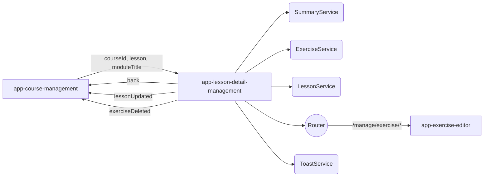
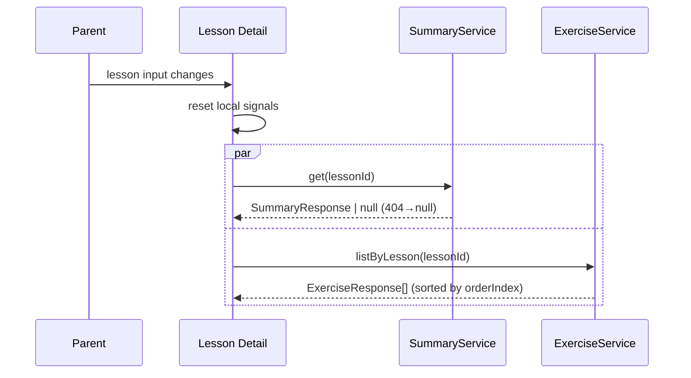

# Lesson Detail Management — Tech Design (5-min)

> Child of [Course Management](../design-5min.md). Read parent for screen-level data flow.

## What we're building

`app-lesson-detail-management`, a standalone child component rendered inside `app-course-management` when `materialSubView === 'lesson-detail'`. Self-loads summary + exercises, edits title and summary inline, navigates to the exercise editor for exercise create/edit, and emits reconciliation events upward.

## System context

## Inputs / outputs

| Direction | Name | Type | Notes |
|---|---|---|---|
| Input | `courseId` | `string` (required) | Used for router navigation paths. |
| Input | `lesson` | `LessonResponse` (required) | Triggers reload of summary + exercises via `effect()` on identity change. |
| Input | `moduleTitle` | `string` (required) | Display only; module badge in header. |
| Output | `back` | `void` | Emitted from back button click. Parent flips `materialSubView` back. |
| Output | `lessonUpdated` | `LessonResponse` | After title save success. Parent updates its tree. |
| Output | `exerciseDeleted` | `string` (id) | After exercise delete success. Parent reconciles cached exercises if needed. |

## Internal state (signals)

- `summary: Signal<SummaryResponse | null>`
- `summaryLoading: Signal<boolean>`
- `exercises: Signal<ExerciseResponse[]>`
- `exercisesLoaded: Signal<boolean>`
- `editingTitle / editTitleValue / savingTitle`
- `editingSummary / editSummaryValue / savingSummary`
- `deleteDialogOpen / deleteExerciseId / deleteExerciseName / deleting`

`effect()` watches `lesson()` and runs `loadLessonData(lesson.id)`, which resets the above and kicks off two parallel fetches (`summaryService.get` with `catchError(() => of(null))`, `exerciseService.listByLesson` with `catchError(() => of([]))`).

## Data flow (sequence)

## Tradeoffs

| Decision | Got | Gave up |
|---|---|---|
| Self-contained data loading | Parent stays simple | Two children fetching independently — harder to coordinate global cache later |
| Inline summary editor | No screen hop | No rich text |
| Vertical list, not `<table>` | Cleaner UI for small N | Less obvious column alignment |
| Optimistic delete | Instant feedback | Rollback complexity |

## Scope

**In:** title inline edit; summary inline edit (textarea, auto-resize); exercises list with edit/delete; delete confirmation; back navigation; loading skeletons.

**Out:** rich-text summary; exercise create/edit forms (delegated to `app-exercise-editor`); reordering; summary version history.

## Failure modes

| Mode | UI |
|---|---|
| Summary 404 | "No summary yet." placeholder |
| Summary fetch network error | Same as 404 (catchError → null); acceptable for v1 |
| Exercises fetch error | Empty list; user can still add |
| Title save error | Toast + remain in edit |
| Summary save error | Toast + remain in edit with current text |
| Delete error | Toast + row stays |

[1-min](./design-1min.md) · [Full](./design-full.md) · [Contract](./contract.yaml) · [PRD](./prd-5min.md) · [Parent](../design-5min.md)
