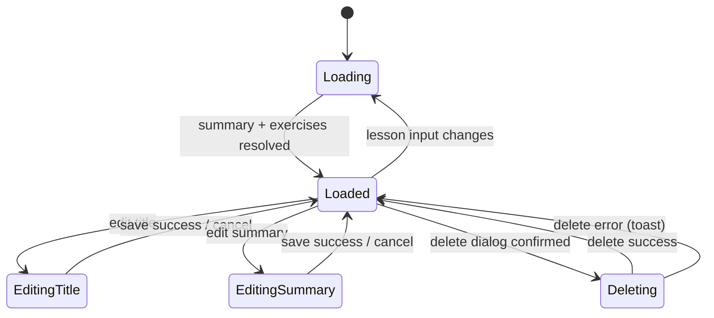

# Lesson Detail Management — Tech Design (Full)

> Inherits the elevator pitch and core decisions from [design-1min.md](./design-1min.md). Parent: [Course Management design](../design-full.md).

## Component map

```
app-lesson-detail-management
├── header
│   ├── back icon-btn → back.emit()
│   ├── lesson title (editable inline)
│   └── module badge
├── summary section
│   ├── header (heading + Edit/Save button)
│   └── body
│       ├── lib-skeleton (loading)
│       ├── summary-card .summary-preview (linkified [innerHTML])
│       └── lib-textarea (edit mode)
└── exercises section
    ├── header (heading + Add Exercise button → router nav)
    ├── lib-skeleton ×3 (loading)
    └── exercise-list
        └── exercise-item × N
            ├── title
            ├── lib-badge (type)
            ├── question count
            └── actions (edit, delete) → router nav / dialog
```

Source files:

- TS: `src/app/components/course-teacher/course-management/lesson-detail-management/lesson-detail-management.component.ts`
- HTML: `…/lesson-detail-management.component.html`
- SCSS: `…/lesson-detail-management.component.scss`

## State machine



## Service surface

| Service | Method | Trigger | On success |
|---|---|---|---|
| SummaryService | `get(lessonId)` | `effect()` on lesson change | sets `summary`, clears `summaryLoading` |
| ExerciseService | `listByLesson(lessonId)` | `effect()` on lesson change | sets `exercises` (sorted by `orderIndex`), sets `exercisesLoaded=true` |
| LessonService | `update(lessonId, { title })` | Save in title inline edit | exits edit, emits `lessonUpdated` |
| SummaryService | `createOrUpdate(lessonId, { content })` | Save in summary edit | sets `summary`, exits edit |
| ExerciseService | `delete(exerciseId)` | Confirm in delete dialog | filters local list, emits `exerciseDeleted` |

API endpoint ids referenced from `documents/network/api-endpoints.yaml`: `summaries.get`, `summaries.create-or-update`, `exercises.list-by-lesson`, `exercises.delete`, `lessons.update`.

## Failure modes

| # | Trigger | UI behavior | Recovery |
|---|---|---|---|
| F1 | Summary returns 404 | Render "No summary yet." placeholder | User clicks Edit to create |
| F2 | Summary fetch network error | `catchError(() => of(null))` — treated as F1 | Acceptable v1; revisit if surfacing matters |
| F3 | Exercises fetch error | `catchError(() => of([]))` — empty list | User can still add |
| F4 | Title update fails | Error toast; stays in edit mode | User retries |
| F5 | Summary save fails | Error toast; textarea preserved | User retries |
| F6 | Delete fails | Error toast; row stays | User retries |
| F7 | Back pressed mid-edit | Edit state lost; no warning prompt | Known limitation (Q3 below) |
| F8 | Linkify pipe XSS | Mitigated only if pipe escapes non-link text | Audit `LinkifyPipe` |

## Decision log

| Date | Decision | Alternatives considered | Why |
|---|---|---|---|
| 2026-02 | Extract from parent into a child component | Keep inline | Parent had grown unwieldy; lesson detail is a self-contained concern. |
| 2026-02 | `effect()`-driven reload on lesson input | `ngOnChanges` lifecycle | Signals-first pattern, consistent with rest of frontend. |
| 2026-02 | `catchError(() => of(null))` for summary | Show explicit error block | A missing summary is the common case; UI affords creation. |
| 2026-03 | Inline summary editing via `lib-textarea` | Separate `/summary/edit` route | One less screen hop; sufficient for plain text. Separate route still listed in parent as TODO if rich text is ever needed. |
| 2026-03 | Vertical `.exercise-list` instead of `<table>` | 4-column table | Reads cleaner with badges and actions; small N. |
| 2026-03 | Persistent red color on delete icon (`icon-btn--danger`) | Hover-only red | Affordance is clearer; matches the rest of the app. |
| 2026-03 | Auto-linkify summary URLs via `LinkifyPipe` + `[innerHTML]` | Plain text only | Teachers paste links to materials; clickable links matter. Trust the pipe to escape non-link text. |

## Open questions

- **Q1 — Summary versioning surface.** Backend tracks `version`. Should the UI show "edited by X on Y"? Useful for accountability when teachers collaborate.
- **Q2 — Rich text.** Out of v1. Decide product priority.
- **Q3 — Unsaved changes guard.** Back button discards inline edits silently. Add a confirm-on-dirty-state guard? Likely yes; v2.
- **Q4 — `LinkifyPipe` audit.** Confirm it escapes any non-link characters before producing HTML. Pending source review.
- **Q5 — User problem framing.** The original spec defined the component without naming the user need. PRDs here infer it; confirm with PM.

[1-min](./design-1min.md) · [5-min](./design-5min.md) · [Contract](./contract.yaml) · [PRD](./prd-full.md) · [Parent](../design-full.md)
