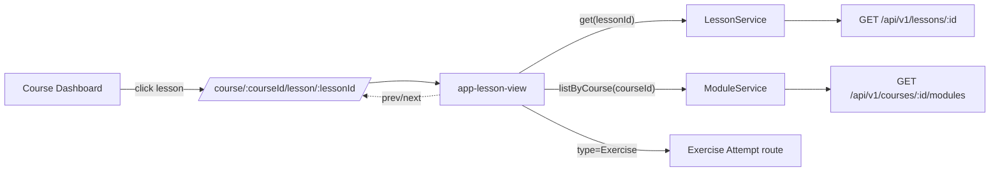

# Lesson View — Tech Design (5 min)

## What we're building
A standalone Angular component, `app-lesson-view`, lazy-loaded at `/course/:courseId/lesson/:lessonId`. It is guarded by the parent `authGuard` only — no role gating. See [contract.yaml](./contract.yaml) for component path.

## System context

The sidebar is the same module accordion the course dashboard uses; we extract it as a shared piece if not already (see open question in [design-full](./design-full.md)).

## Data flow

| Source | Used for |
|---|---|
| Route params `courseId`, `lessonId` | Triggering the two service calls |
| `LessonService.get(lessonId)` | Title, type, body, resources |
| `ModuleService.listByCourse(courseId)` | Sidebar tree, position math, Prev/Next targets |

State lives in three signals on the component:

- `lesson = toSignal(lessonService.get(lessonId$))`
- `modules = toSignal(moduleService.listByCourse(courseId$))`
- `position = computed(() => calcPosition(lessonId, modules()))`

Prev/Next targets are also `computed()` from `modules()`.

## Key decisions & alternatives

| Decision | Why | Alternative rejected |
|---|---|---|
| **Type-dispatched body** (`@switch` on `lesson.type`) | One route + one URL shape, Prev/Next work across types uniformly | Separate route per type — Prev/Next becomes cross-route navigation, breaks deep-linking by lesson id |
| **Client-side position math** | No new endpoint; we already fetch modules for the sidebar | Server returns `{position, total}` with the lesson — premature, extra payload |
| **Exercise redirects to attempt screen** | Keep submission lifecycle out of the lesson page | Inline iframe / embed — submission and routing get tangled, hard to share state |
| **Hide sidebar on mobile, no drawer** | Smallest deliverable that meets AC9; drawer is pure UX scope | Drawer / hamburger — out of scope this iteration |
| **No background or border on sidebar** | Project design rule (unified surface, see `documents/design-system/design-principles.yaml`) | Distinct sidebar surface — explicitly prohibited by design principles |

## Tradeoffs
- Computing position client-side means a stale module cache could mislabel the position; mitigated by always fetching `modules` alongside the lesson and treating "lesson not in modules" as not-found (see AC8).
- Type-dispatched body keeps everything in one component, so the file will grow as we add lesson types. We accept that until a 5th type appears, then split.

## Scope (mirrors PRD)
**In:** route, header, type badge, type-dispatched body for Summary/Video/Quiz, Exercise redirect, sidebar reuse, Prev/Next, loading/error/404, auto-complete for video and reading, mobile no-sidebar layout.

**Out:** authoring, inline Exercise rendering, drawer sidebar on mobile, comments, bookmarks, offline.

## Failure modes (summary)
- Network error on lesson fetch → error state with Retry.
- 404 from lesson endpoint → not-found state.
- 401/403 → bubbled to global `errorInterceptor`, redirects to login.
- Lesson id not in module list → not-found.
- Empty body → empty-state hint, screen still renders.

Full table in [design-full](./design-full.md).

## Links
[1-min](./design-1min.md) · [full](./design-full.md) · [PRD](./prd-1min.md) · [contract](./contract.yaml)
