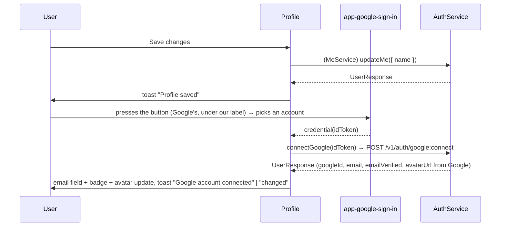

# Profile — Tech Design (5 min)

> The signed-in user's account page. Component: `src/app/components/profile/profile.component.ts` (standalone, signals). PRD: [`prd-5min.md`](./prd-5min.md).

## What we're building

Route `/profile` (`authGuard`), reached from the navbar avatar menu. Shows the user, edits the display name, and connects or switches the Google account through `app-google-sign-in` (the same Google Identity Services button `/login` and `/register` use). The email is read-only: it is whatever the server returns after a connect.

## System context

```
 navbar avatar menu ──routerLink──▶ /profile (app-profile) ── app-google-sign-in
                                        │                       (credential output → connectGoogle)
                  ┌─────────────────────┼──────────────────────┐
                  ▼                     ▼                      ▼
        AuthService                MeService              ToastService
        currentUser / setCurrentUser   getMe / updateMe   (lib-toast)
        connectGoogle(idToken)          │
            │   ▲                       ▼
            │   │               /api/v1/users/me
            ▼   │
      /api/v1/auth/google:connect
            │
            ▼
      localStorage 'user' → navbar userName() / userInitial() / avatar
```

## Data flow

| Signal / source | Origin | Drives |
|---|---|---|
| `user` | `AuthService.currentUser()` on construct, then every returned `UserResponse` | Header, email field, badge, button label |
| `form` | `FormBuilder.nonNullable.group` (`username` disabled, `name`, `email` disabled) | Save (name only) |
| `googleLabel` / `googleHint` | `computed` from `user` and `isConnecting` | The wording drawn over Google's button, and the line under it while the email is unverified |
| `isLoading` / `isSaving` / `isConnecting` | Call lifecycles | Spinner, Save loading, "Connecting…" on the button |
| `errorMessage` | `apiErrorMessage(err, fallback)` | Alert under the form |

`applyUser(user)` is the one write path for the user: sets `user` and calls `AuthService.setCurrentUser` (`connectGoogle` also taps `setCurrentUser`, harmlessly twice). The form is reset from the user on load; after Save only the name control is reset, after a connect only the email control.

### Sequences



## Tradeoffs

| Choice | Gives us | Costs |
|---|---|---|
| Render cached user, then refresh | Instant paint | Brief flash if the server copy differs; a pre-release cache lacks `googleConnected` until then |
| Server-owned email, page never edits it | No validation, no pending state, no code dialog | Accounts without Google cannot change their address at all |
| Our label over Google's button (`[label]`) | The button says what it does ("Connect other Google account") | Sizes must stay pinned together (280x40) or clicks miss; screen readers announce Google's wording; cannot be disabled in flight |
| `connectGoogle` on `AuthService`, not `MeService` | Matches the `/v1/auth` URL and keeps `setCurrentUser` in one place | `AuthService` grows by one method |
| No confirm before switching | One click, one component fewer | A mis-click moves sign-in; reversible, and the server mails the old address |

## Scope (mirrors PRD)

**In:** read-only username and email; display name edit; Verified / Unverified badge; Google button wearing our label, with a hint under it while the email is unverified; toasts; 520px centered column.

**Out:** disconnect Google, confirm step, avatar upload, password change/reset, account deletion, username change.

## Failure modes

- **`getMe` fails:** cached user stays visible; with no cache, error text replaces the spinner.
- **409 on connect (Google account or address taken):** reason under the form; nothing changes.
- **401 "Google account email is not verified" / "Invalid Google token":** reason under the form. `errorInterceptor` lets these through because they are 401s; an expired session on the same URL takes the normal refresh → logout path, since the interceptor excludes `google:connect` from the `/v1/auth/` rule only for that purpose. (In practice the refresh endpoint is a stub, so both end at `/login` when the token is gone and the Google 401s never reach that branch because the JWT filter runs first.)
- **Google script blocked:** nothing to press. The face is painted only once Google's button exists (`rendered` signal), so a blocked script never leaves a dead-looking button.
