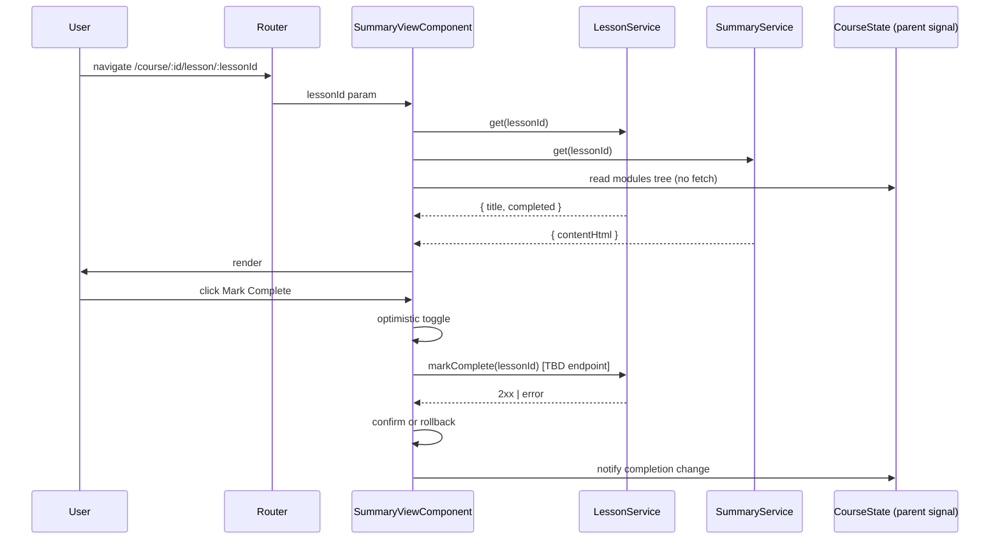

# Summary View — Tech Design (full)

## 1. Component map

```
SummaryViewComponent (standalone)
├── inputs (route params)
│   ├── courseId  (from parent route)
│   └── lessonId  (from this route)
├── signals
│   ├── lesson$    — toSignal(LessonService.get(lessonId$))
│   ├── summary$   — toSignal(SummaryService.get(lessonId$))
│   ├── nav$       — computed(prev/next from parent course-state signal)
│   └── completed$ — derived from lesson$ + optimistic local override
├── template
│   ├── <header> lesson title
│   ├── <article> sanitized HTML + LinkifyPipe
│   └── <footer> lib-button × 3  (prev | mark complete | next)
└── pipes
    ├── LinkifyPipe       (existing — auto-linkify plain URLs)
    └── DomSanitizer.bypassSecurityTrustHtml(serverSanitizedHtml)
```

The component must NOT render its own sidebar or breadcrumb. Those live in `course-layout`. If you find yourself adding `<aside>` or `<nav class="breadcrumb">` to `summary-view.component.html`, stop — read `documents/design-system/design-principles.yaml` §"Unified Surface".

## 2. Data flow



## 3. State machine

| State | Enter when | UI |
|---|---|---|
| `loading` | `summary$` or `lesson$` pending | Skeleton title + body, footer buttons disabled. |
| `loaded` | both signals resolved with data | Title, content, footer enabled per first/last rules. |
| `empty` | `summary$` resolved with 404 / null | "No content yet" message, footer still works. |
| `completed` | `completed$ === true` | Mark Complete renders as "Completed" (checked). |
| `error` | any call rejects (non-401) | Error message + "Back to course" button. |
| `auth-error` | 401 | Handled by `errorInterceptor` → `/login`. |

## 4. Failure modes

| Failure | Detection | Handling |
|---|---|---|
| Summary endpoint 404 | `SummaryService.get` resolves with null/404 | Render `empty` state; do not block prev/next. |
| Summary endpoint 5xx | service rejects | `error` state, retry action re-issues `get`. |
| Lesson endpoint failure | `LessonService.get` rejects | `error` state — title is required, can't render meaningfully. |
| Network offline mid-render | RxJS error | `error` state with "Check your connection" copy. |
| Mark Complete fails | service rejects | Rollback optimistic state, surface inline error toast. |
| Mark Complete endpoint missing in backend | no `lessons.complete` route exists | Hide the button behind a feature flag or block release on R1 (see PRD-full §7). |
| Invalid `lessonId` | both endpoints 404 | `error` state, "Back to course" link to `/course/:courseId`. |
| Sidebar fetch fails (parent layout) | parent's responsibility | Summary still renders; prev/next may be disabled. |

## 5. Decision log

| Date | Decision | Why | Alternatives rejected |
|---|---|---|---|
| 2026-05-06 | Render inside `course-layout` via `<router-outlet>`. | Sidebar/breadcrumb already live there; reuse parent state; avoid double fetches. | Standalone page redrawing sidebar (drift); rebuilding the layout in this component (scope creep). |
| 2026-05-06 | Manual Mark Complete only. | Unambiguous, no heuristic to tune, no a11y edge cases. | Auto-complete on scroll/dwell (false positives, hard for screen readers). |
| 2026-05-06 | Optimistic UI for Mark Complete. | Toggle is one bit; rollback on error is trivial. | Pessimistic — adds noticeable delay to a binary action. |
| 2026-05-06 | Use `lib-button` for footer controls. | Themed via tokens, matches Course Dashboard. | Custom buttons (re-implements states, breaks theme). |
| 2026-05-06 | `DomSanitizer` + `LinkifyPipe` for content render. | Standard Angular pipeline; pipe already exists. | Custom HTML parser (security risk). |
| 2026-05-06 | Recommend route shape **option 3** — summary-view is the default tab content of `course-lesson`. | Aligns with Course Dashboard PRD's tabbed Summary/Exercises/Submissions intent; keeps URLs short. | Option 1 (replace `course-lesson`) couples this scaffold to a larger refactor; option 2 (`/summary` suffix) adds a redundant segment for the default view. **Pending sign-off.** |

## 6. Open questions

1. **Mark-complete endpoint shape.** Probably `POST /v1/lessons/{lessonId}/completion` with `{ completed: boolean }`, but undefined. Confirm with backend.
2. **Content format.** HTML or Markdown from `summaries.get`? Affects whether we need a Markdown renderer.
3. **Route shape.** See §5 row 6 — needs FE lead sign-off.
4. **Mobile drawer state on lesson change.** Should the drawer auto-close after picking a lesson? Probably yes; confirm with design.
5. **What does the sidebar `completed` flag come from?** Same source as `lesson$.completed` ideally — avoid two truths.

## 7. Non-goals (restated)

- No editing.
- No auto-completion.
- No comments, highlights, bookmarks.
- No analytics.
- No server-side progress percentages.

## 8. Implementation pointers (no code paste)

- Component file: `src/app/components/course/summary-view/summary-view.component.ts` (currently a scaffold).
- Wire under whichever route shape wins §5 row 6 — update `app.routes.ts` accordingly.
- Reuse `lib-button`, `lib-spinner`, `LinkifyPipe`. No new shared components needed.
- Hard rule reminder: do not put `background-color`, `border-left`, or `border-right` on the parent's sidebar from styles in this component. (See `lib4gz-fe/CLAUDE.md` §"Design Principles".)
