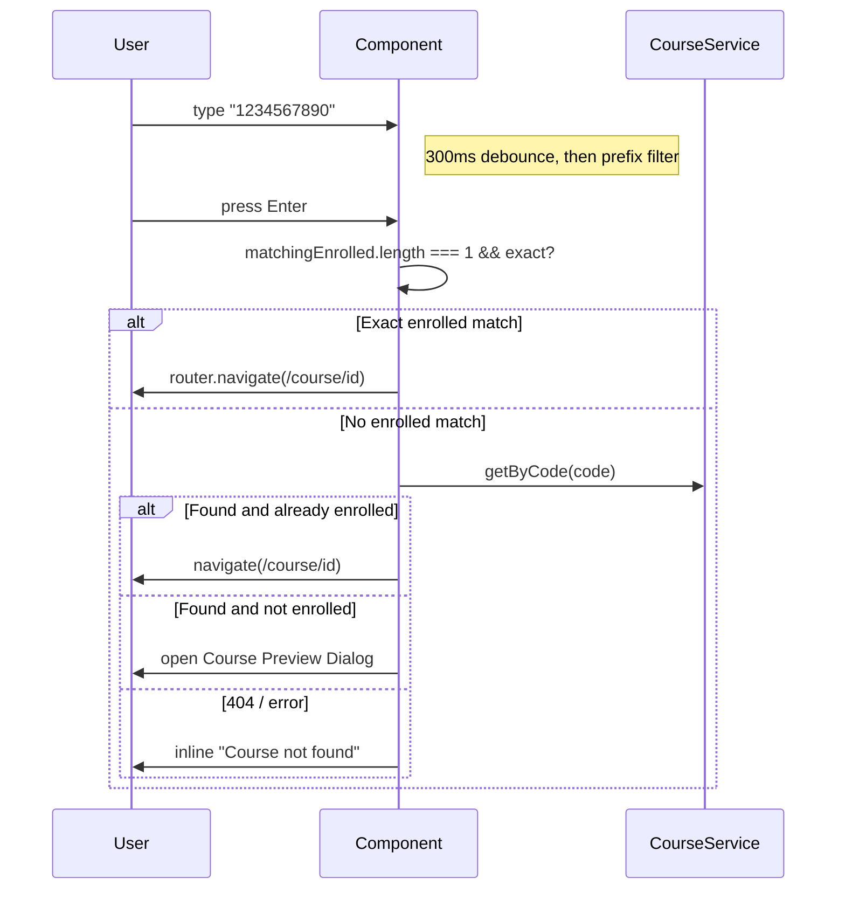

# User Dashboard — Tech Design (5 min)

> The post-login landing screen. Component lives at `src/app/components/home/user-dashboard/user-dashboard.component.ts` (standalone, signals-based).

## What we're building

One screen, route `/`, behind `authGuard`. It fetches `enrolled` and `created` courses in parallel, renders a tabbed card grid, and exposes a code-based course finder that can resolve to navigation, an apply dialog, or an error.

## System context

```
                 +------------------+
   /login   -->  | UserDashboard /  |  <-- AuthService.hasRole / getUserName
                 |  app-user-       |
                 |  dashboard       |
                 +---+---+----+-----+
                     |   |    |
       list enrolled |   |    | enroll
       list created  |   |    |
       create        |   |    |
       getByCode     |   |    |
                     v   v    v
            CourseService    EnrollmentService
                     |              |
                     +------+-------+
                            v
            backend  /api/v1/courses, /v1/courses/{id}/enroll
                            |
                            v
                  Routing targets:
                    /course/{id}           (student)
                    /course/{id}/manage    (teacher / new course)
```

Sibling screens consumed via navigation:

- `/course/:id` — student course dashboard (separate spec).
- `/course/:id/manage` — teacher management hub (separate spec).

## Data flow

| Signal / source | Origin | Drives |
|---|---|---|
| `userName` | `AuthService.getUserName()` set on init | Welcome message |
| `enrolledCourses` | `CourseService.list('enrolled')` | My Courses grid, dropdown matches |
| `createdCourses` | `CourseService.list('created')` | Teaching grid |
| `activeTab` | User click + auto-fallback | Which list `filteredCourses` returns |
| `filteredCourses` (computed) | `activeTab` + the two list signals | Grid render |
| `searchCodeInput` | `Subject` debounced 300ms | `matchingEnrolledCourses` |
| `matchingEnrolledCourses` (computed) | prefix filter on `enrolledCourses` | Dropdown render |
| `previewCourse` | `CourseService.getByCode` result | Preview dialog content |
| `applySuccess` / `applyError` | `EnrollmentService.enroll` outcome | Inline badge in preview dialog |
| `canCreateCourse` (computed) | `AuthService.hasRole(TEACHER, ADMIN)` | Visibility of *+ Create Course* |
| `createForm` | `FormBuilder.nonNullable.group` | Create dialog form |

The component subscribes to API observables directly inside `subscribe(...)` callbacks — there is no NgRx, no facade. That matches the codebase convention.

### Search-Enter sequence



## Tradeoffs

| Choice | Gives us | Costs |
|---|---|---|
| Tabs over two routes | Shared layout, single mount | Slightly heavier initial fetch (both lists) |
| Prefix-filter client-side, Enter-only `getByCode` | Snappy typing, fewer requests | Users must press Enter to discover non-enrolled codes |
| Inline dialog feedback (success badge inside preview) instead of toast | Keeps context, less infra | Needs a delayed-close timer |
| Direct `subscribe` in the component | Matches codebase, no extra layer | Harder to unit-test than facade-based components |
| `setTimeout(1500ms)` to close preview dialog after success | Lets user read confirmation | Manual timer = potential test flake; cancellable on unmount needed if the component is destroyed |

## Scope (mirrors PRD)

**In:** tabbed list of enrolled vs. created courses; responsive 4/3/1 grid; code search with dropdown + `getByCode` fallback; preview-and-apply dialog; create-course dialog (TEACHER/ADMIN); skeletons, empty, error, retry.

**Out:** real progress %, real thumbnails, last-activity timestamp, sorting controls, pagination, instructor-approval workflow surfacing, badge counts as a designed feature, analytics wiring.

## Failure modes

- **API down on initial load:** the first error sets `errorMessage` and exits the loading state; *Retry* button re-runs `loadCourses()`.
- **401 mid-session:** `errorInterceptor` is expected to redirect to `/login`; this screen does not handle 401 specifically.
- **Race between dialog close and reload:** `loadCourses()` is fired *before* the 1500ms close timeout, so the grid is already up-to-date when the dialog disappears.
- **Component destroyed while a request is in flight:** `takeUntilDestroyed(destroyRef)` is wired only on the search `Subject`. The `subscribe` chains for list/get/create/enroll do not — minor leak risk but no functional issue beyond a stray `set()` on a dead component, which is a no-op for signals. Flagged as an open question.
